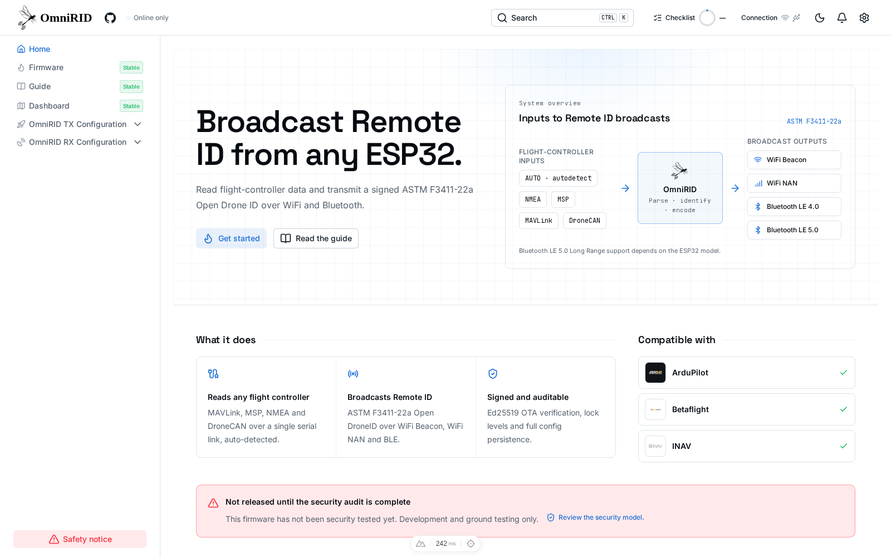

<p align="center">
  
</p>

<p align="center">
  <a href="https://github.com/VOLTEKOVER/OmniRID-Universal-Drone-ID/actions/workflows/esp32-build.yml"></a>
  <a href="https://github.com/VOLTEKOVER/OmniRID-Universal-Drone-ID/releases"></a>
  <a href="https://github.com/VOLTEKOVER/OmniRID-Universal-Drone-ID/blob/main/LICENSE"></a>
</p>

# Open Remote ID, made for ESP32

**OmniRID** is an open-source Remote ID transmitter and companion web app for ESP32. It reads flight data from a flight controller or GPS source, builds ASTM F3411-22a Remote ID messages, and broadcasts them over supported Wi-Fi and Bluetooth modes.

The firmware is written in Rust. The web app helps configure the device, monitor its status, and check settings.

## Screenshots

<p align="center">
  
</p>

<p align="center">
  
</p>

## At a glance

- **Inputs:** MAVLink, MSP, NMEA, and DroneCAN.
- **Broadcast:** ASTM Remote ID over Wi-Fi Beacon, Wi-Fi NAN, and chip-dependent Bluetooth modes.
- **Supported boards:** ESP32, ESP32-S3, and ESP32-C6, with hardware-specific capabilities.
- **Companion app:** device configuration, live dashboard, readiness checklist, and firmware tools.
- **Bench testing:** demo mode can simulate a GPS patrol without a flight controller.

## Get started

1. Choose a supported ESP32 board and flash the firmware.
2. Connect to the device's Wi-Fi network (`ESP-RID` by default).
3. Open the OmniRID web app and connect to the device.
4. Configure the identity, input, and broadcast settings; use demo mode for bench testing.

The complete installation, configuration, troubleshooting, and protocol reference is in the app's [Guide](OmniRID-app/app/pages/guide.vue).

## Project

- [Web app](OmniRID-app/)
- [Firmware](OmniRID-firmware/)
- [Guide content](OmniRID-app/app/config/guide.ts)
- [Issues and discussions](https://github.com/VOLTEKOVER/OmniRID-Universal-Drone-ID/issues)

For app development:

```bash
cd OmniRID-app
pnpm install
pnpm dev
```

> **Development and ground testing only.** OmniRID has not completed its security audit and is not approved or certified for flight. Verify applicable Remote ID requirements before any operational use. See [SECURITY.md](SECURITY.md).
